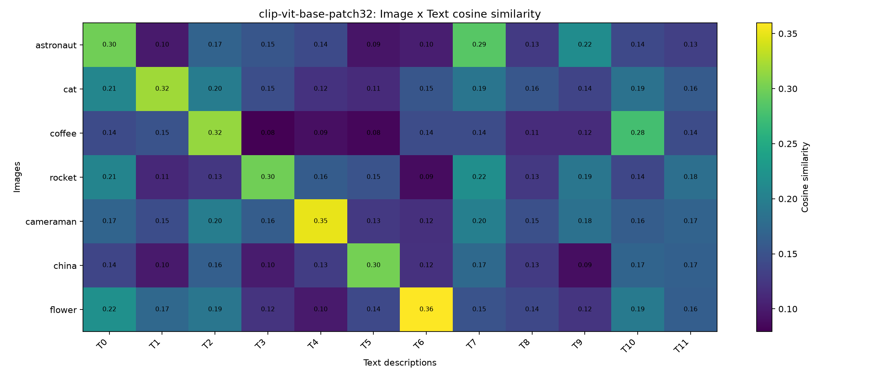
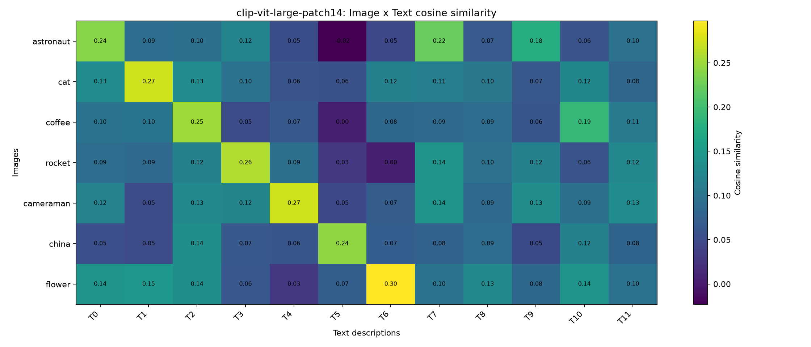
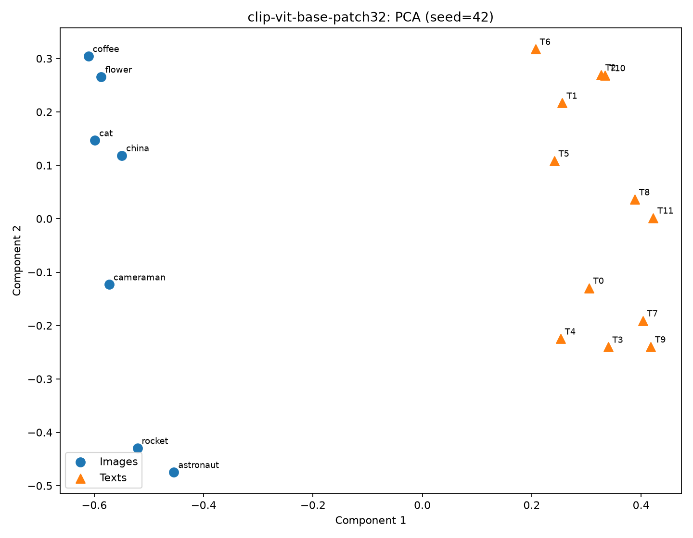
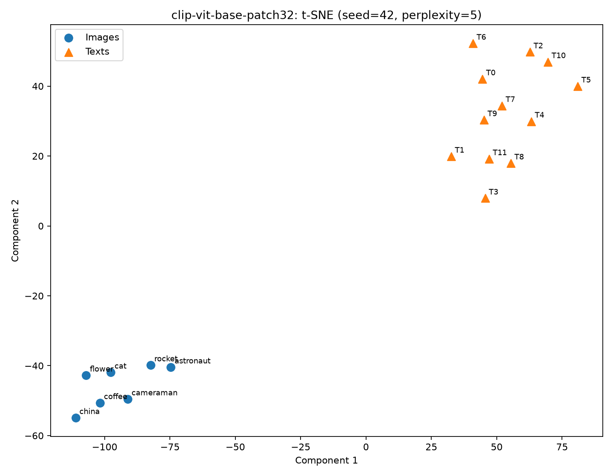
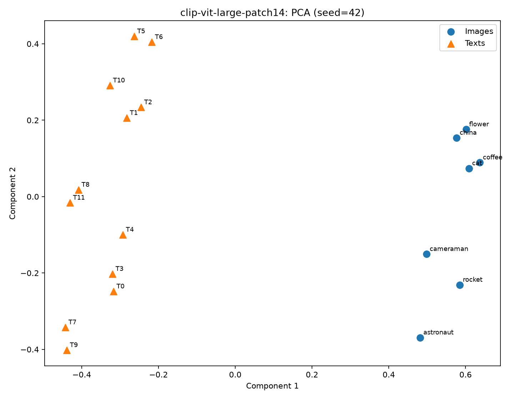
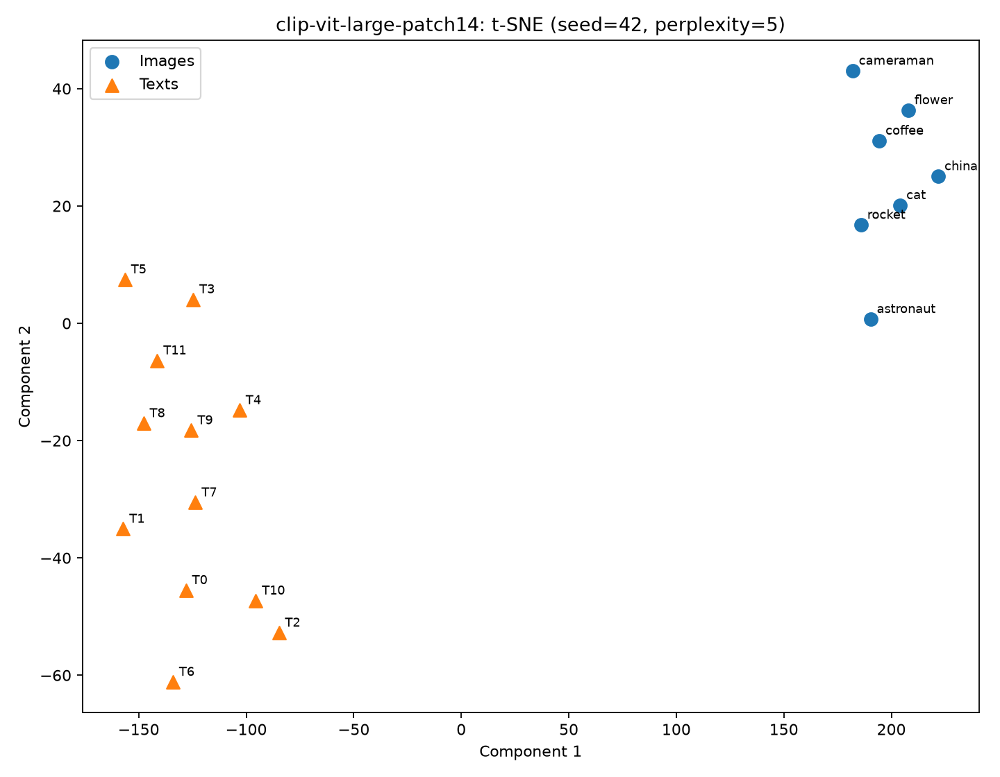

# Retrieval versus geometry: image-text retrieval with CLIP ViT-B/32 and ViT-L/14

## 1. Summary

Retrieval accuracy and embedding geometry answer different questions. On a 7-image, 12-text study, CLIP ViT-B/32 and ViT-L/14 both reach 100% Top-1 in both directions, but matched image-text pairs are **not** nearest neighbours in 2D projections: the nearest text is a valid match for only 2/7 (B/32) and 3/7 (L/14) images under PCA, and 1/7 and 1/7 under t-SNE. Images and texts occupy separate regions, the *modality gap*. Retrieval survives because it depends only on the order of scores within one query.

## 2. Model and contrastive training

Both checkpoints have an image encoder and a text encoder whose outputs are projected into one shared space and L2-normalised, so a dot product is a cosine similarity.

**Image encoder.** A Vision Transformer. The image is resized to 224x224 and cut into non-overlapping patches (32x32 pixels for B/32, giving 49 patches; 14x14 for L/14, giving 256). Each patch is linearly embedded, a learned class token and position embeddings are added, and the sequence passes through a stack of transformer encoder layers. The class-token output is layer-normalised and mapped by a learned linear **projection** to the shared space (512-d for B/32, 768-d for L/14).

**Text encoder.** A 12-layer transformer with causal (masked) self-attention over byte-pair-encoded tokens (context length 77, start and end tokens). The activation at the end-of-text token is layer-normalised and mapped by its own linear projection to the same dimension as the image side. The two projections are what make the towers comparable: neither raw encoder output lives in the shared space.

**Contrastive training.** For a batch of N image-text pairs the model builds an N x N matrix of cosines scaled by a learned temperature and applies a symmetric softmax cross-entropy: each image must pick its own text among the N texts (rows), and each text its own image (columns). The N matching pairs on the diagonal are pulled together; the N^2-N non-matching pairs in the batch act as negatives and are pushed apart. At test time, retrieval is just ranking by cosine similarity.

## 3. Data

Seven images (astronaut, cat, coffee, rocket, cameraman, china, flower) and twelve texts. Astronaut has two valid texts (T0 portrait in an orange spacesuit, T7 person wearing a space suit). T8-T11 have no valid image: a dog, an airplane, and two near-miss distractors (T9 astronaut on the moon, T10 cup of tea on a wooden table). Eight further hard distractors (a rose, a lighthouse, a lion, hot chocolate, tea or hot chocolate on a red saucer, a person in an orange jacket with a helmet, and others) form the expanded run, which is always reported separately. Labels live in `data/labels.json` and were fixed before any evaluation.

Metrics use stable tie-breaking (ties favour the lower index) so output is reproducible. Excluded queries: **0 image queries and 4 text queries (T8-T11)** per model; excluded queries remain in the matrices and rankings.

## 4. Core retrieval results (CLIP)

| Model | I2T Top-1 | I2T Mean Rank | T2I Top-1 | T2I Mean Rank |
|---|---:|---:|---:|---:|
| CLIP ViT-B/32 | 100% (7/7) | 1.00 | 100% (8/8) | 1.00 |
| CLIP ViT-L/14 | 100% (7/7) | 1.00 | 100% (8/8) | 1.00 |

Similarity matrices (cosine, labelled images x texts):




Every image's best description is a valid one in both models. The top scores are low in absolute terms (about 0.30-0.36 for B/32, 0.24-0.30 for L/14), which is typical of CLIP; L/14 gives lower numbers everywhere without changing any ranking. Full rankings are in `results/rankings.txt` and are reproduced in the appendix.

The two models tie on every retrieval metric, so this data cannot say which is better.

## 5. Do matched pairs appear close? 2D distances vs. cosine

The joint embedding (7 images + 12 texts = 19 points) was reduced with PCA and t-SNE (seed 42, perplexity 5, below the number of points).

| Quantity | CLIP B/32 | CLIP L/14 |
|---|---:|---:|
| Centroid distance, image mean to text mean | 0.883 | 0.905 |
| Mean cosine, valid pairs | 0.316 | 0.258 |
| Mean cosine, invalid pairs | 0.149 | 0.091 |
| Nearest text valid in 2D, PCA | 2/7 | 3/7 |
| Nearest text valid in 2D, t-SNE | 1/7 | 1/7 |
| Retrieval Top-1, image to text | 7/7 | 7/7 |






Images and texts form two separate groups in all four plots; the first PCA axis mostly separates the modalities. Within a modality there is structure that agrees with the cosine matrices: text-text cosines are highest for T2-T10 (espresso and tea, 0.816 in B/32) and T7-T9 (space suit and astronaut on the moon, 0.784 in B/32), and the cat, coffee and flower images have the highest image-image cosines. Not everything in 2D survives the check: astronaut and rocket sit close in the PCA plots, but that pair is not among the highest image-image cosines, so that proximity is a projection effect. In the L/14 t-SNE plot the images collapse into one tight blob that carries little information. Because 2D distances can mislead, conclusions here are the ones the cosine statistics also support.

The reading: a matched pair is the best match *within a ranking*, but the pair is still far apart in absolute terms because a large offset separates the image cloud from the text cloud. Cosine ranking cancels that offset; Euclidean distance in a 2D projection does not. This is consistent with the modality gap described by Liang et al. (2022).

## 6. Failure analysis

**No top-1 error occurred** in either direction for either CLIP model on the core set, or on the expanded set of 20 texts (12 core + 8 hard distractors): the expanded run is also 100% Top-1 with Mean Rank 1.00, reported separately from the core table (see `results/expanded_evaluation.json`). The failure analysis below therefore uses the closest near-misses, and says so; it is not a real top-1 error. (The code records and plots any real error automatically in `results/*_failure_case.png`.)

| Image | Model | Best invalid text | Score | Best valid score | Margin |
|---|---|---|---:|---:|---:|
| coffee | B/32 | T10 cup of tea on a wooden table | 0.276 | 0.315 | 0.040 |
| astronaut | B/32 | T9 astronaut walking on the moon | 0.216 | 0.299 | 0.083 |
| coffee | L/14 | T10 cup of tea on a wooden table | 0.190 | 0.252 | 0.062 |
| astronaut | L/14 | T9 astronaut walking on the moon | 0.177 | 0.240 | 0.064 |

Scores come from `results/evaluation.json` (margin = best valid score minus best invalid score, three decimals). Two other near-misses are worth noting: for the rocket image on B/32, T7 "a person wearing a space suit" scores 0.218 against 0.299 (margin 0.081), and for the china image on L/14, T2 scores 0.136 against 0.244 (margin 0.108). Failure type for both: fine-grained attribute confusion, from CLIP's tendency to encode the object category (a cup, an astronaut) more strongly than the attribute that separates the texts (tea versus espresso, a portrait versus a scene on the moon). The coffee case is the closest: the distractor shares the "cup of hot drink" concept and the text-text cosine of T2 and T10 is high.

## 7. Strengths, limitations and when CLIP fails

CLIP gives zero-shot cross-modal retrieval from free text without task training, and it handled near-miss distractors and a grayscale image here. It is weaker on fine-grained attributes, counting, spatial relations and negation, depends on prompt wording, and its scores are not calibrated probabilities. The modality gap makes raw Euclidean comparisons between an image embedding and a text embedding unreliable.

The dataset is very small: results on 7 images cannot establish general superiority of any model, and the two CLIP checkpoints are indistinguishable here.

## 8. Reproducing

```bash
pip install -r requirements.txt
python src/clip_eval.py               # writes results/, including summary.md
```

Seed 42 for NumPy, PyTorch, PCA and t-SNE; t-SNE perplexity 5 (19 points: 7 images + 12 texts).

## References

Radford et al. 2021, *Learning Transferable Visual Models From Natural Language Supervision* (arXiv:2103.00020). Liang et al. 2022, *Mind the Gap: Understanding the Modality Gap in Multi-modal Contrastive Representation Learning* (arXiv:2203.02053).

## Appendix: full rankings

Cosine scores to three decimals; * marks a valid match.

```text
## clip-vit-base-patch32
### Image -> Text
astronaut: T0*(0.299) > T7*(0.287) > T9(0.216) > T2(0.168) > T3(0.154) > T4(0.142) > T10(0.141) > T11(0.132) > T8(0.127) > T6(0.103) > T1(0.099) > T5(0.095)
cat: T1*(0.319) > T0(0.208) > T2(0.198) > T7(0.188) > T10(0.185) > T11(0.160) > T8(0.156) > T6(0.154) > T3(0.146) > T9(0.136) > T4(0.120) > T5(0.114)
coffee: T2*(0.315) > T10(0.276) > T1(0.151) > T7(0.145) > T6(0.144) > T11(0.144) > T0(0.143) > T9(0.115) > T8(0.114) > T4(0.091) > T5(0.084) > T3(0.079)
rocket: T3*(0.299) > T7(0.218) > T0(0.206) > T9(0.189) > T11(0.182) > T4(0.161) > T5(0.151) > T10(0.139) > T8(0.126) > T2(0.125) > T1(0.112) > T6(0.089)
cameraman: T4*(0.351) > T7(0.200) > T2(0.198) > T9(0.184) > T0(0.169) > T11(0.168) > T3(0.162) > T10(0.162) > T8(0.148) > T1(0.146) > T5(0.126) > T6(0.118)
china: T5*(0.301) > T7(0.175) > T10(0.169) > T11(0.166) > T2(0.164) > T0(0.138) > T4(0.130) > T8(0.128) > T6(0.120) > T3(0.101) > T1(0.100) > T9(0.089)
flower: T6*(0.360) > T0(0.220) > T10(0.194) > T2(0.190) > T1(0.174) > T11(0.163) > T7(0.151) > T5(0.142) > T8(0.140) > T9(0.123) > T3(0.121) > T4(0.099)
### Text -> Image
T0 (a portrait of an astronaut in an orange spacesuit): astronaut*(0.299) > flower(0.220) > cat(0.208) > rocket(0.206) > cameraman(0.169) > coffee(0.143) > china(0.138)
T1 (a close-up photo of a tabby cat's face): cat*(0.319) > flower(0.174) > coffee(0.151) > cameraman(0.146) > rocket(0.112) > china(0.100) > astronaut(0.099)
T2 (a cup of espresso on a red saucer): coffee*(0.315) > cameraman(0.198) > cat(0.198) > flower(0.190) > astronaut(0.168) > china(0.164) > rocket(0.125)
T3 (a rocket standing on a launch pad at night): rocket*(0.299) > cameraman(0.162) > astronaut(0.154) > cat(0.146) > flower(0.121) > china(0.101) > coffee(0.079)
T4 (a black and white photo of a man filming with a camera on a tripod): cameraman*(0.351) > rocket(0.161) > astronaut(0.142) > china(0.130) > cat(0.120) > flower(0.099) > coffee(0.091)
T5 (a multi-story traditional Chinese pagoda among trees): china*(0.301) > rocket(0.151) > flower(0.142) > cameraman(0.126) > cat(0.114) > astronaut(0.095) > coffee(0.084)
T6 (an orange dahlia flower): flower*(0.360) > cat(0.154) > coffee(0.144) > china(0.120) > cameraman(0.118) > astronaut(0.103) > rocket(0.089)
T7 (a person wearing a space suit): astronaut*(0.287) > rocket(0.218) > cameraman(0.200) > cat(0.188) > china(0.175) > flower(0.151) > coffee(0.145)
T8 (a dog running on grass): cat(0.156) > cameraman(0.148) > flower(0.140) > china(0.128) > astronaut(0.127) > rocket(0.126) > coffee(0.114)
T9 (an astronaut walking on the moon): astronaut(0.216) > rocket(0.189) > cameraman(0.184) > cat(0.136) > flower(0.123) > coffee(0.115) > china(0.089)
T10 (a cup of tea on a wooden table): coffee(0.276) > flower(0.194) > cat(0.185) > china(0.169) > cameraman(0.162) > astronaut(0.141) > rocket(0.139)
T11 (an airplane taking off from a runway): rocket(0.182) > cameraman(0.168) > china(0.166) > flower(0.163) > cat(0.160) > coffee(0.144) > astronaut(0.132)

## clip-vit-large-patch14
### Image -> Text
astronaut: T0*(0.240) > T7*(0.223) > T9(0.177) > T3(0.120) > T11(0.096) > T2(0.095) > T1(0.093) > T8(0.068) > T10(0.059) > T4(0.053) > T6(0.047) > T5(-0.023)
cat: T1*(0.274) > T0(0.133) > T2(0.132) > T10(0.123) > T6(0.117) > T7(0.113) > T8(0.105) > T3(0.099) > T11(0.083) > T9(0.066) > T4(0.061) > T5(0.056)
coffee: T2*(0.252) > T10(0.190) > T11(0.109) > T1(0.101) > T0(0.100) > T8(0.092) > T7(0.088) > T6(0.085) > T4(0.066) > T9(0.062) > T3(0.050) > T5(0.004)
rocket: T3*(0.260) > T7(0.144) > T11(0.125) > T2(0.118) > T9(0.118) > T8(0.098) > T4(0.095) > T0(0.092) > T1(0.086) > T10(0.060) > T5(0.030) > T6(0.005)
cameraman: T4*(0.273) > T7(0.142) > T9(0.133) > T11(0.133) > T2(0.126) > T3(0.123) > T0(0.119) > T10(0.095) > T8(0.087) > T6(0.072) > T1(0.050) > T5(0.048)
china: T5*(0.244) > T2(0.136) > T10(0.117) > T8(0.091) > T11(0.080) > T7(0.076) > T6(0.073) > T3(0.067) > T4(0.063) > T0(0.055) > T1(0.050) > T9(0.049)
flower: T6*(0.297) > T1(0.148) > T0(0.143) > T10(0.142) > T2(0.137) > T8(0.130) > T7(0.100) > T11(0.099) > T9(0.084) > T5(0.074) > T3(0.064) > T4(0.032)
### Text -> Image
T0 (a portrait of an astronaut in an orange spacesuit): astronaut*(0.240) > flower(0.143) > cat(0.133) > cameraman(0.119) > coffee(0.100) > rocket(0.092) > china(0.055)
T1 (a close-up photo of a tabby cat's face): cat*(0.274) > flower(0.148) > coffee(0.101) > astronaut(0.093) > rocket(0.086) > china(0.050) > cameraman(0.050)
T2 (a cup of espresso on a red saucer): coffee*(0.252) > flower(0.137) > china(0.136) > cat(0.132) > cameraman(0.126) > rocket(0.118) > astronaut(0.095)
T3 (a rocket standing on a launch pad at night): rocket*(0.260) > cameraman(0.123) > astronaut(0.120) > cat(0.099) > china(0.067) > flower(0.064) > coffee(0.050)
T4 (a black and white photo of a man filming with a camera on a tripod): cameraman*(0.273) > rocket(0.095) > coffee(0.066) > china(0.063) > cat(0.061) > astronaut(0.053) > flower(0.032)
T5 (a multi-story traditional Chinese pagoda among trees): china*(0.244) > flower(0.074) > cat(0.056) > cameraman(0.048) > rocket(0.030) > coffee(0.004) > astronaut(-0.023)
T6 (an orange dahlia flower): flower*(0.297) > cat(0.117) > coffee(0.085) > china(0.073) > cameraman(0.072) > astronaut(0.047) > rocket(0.005)
T7 (a person wearing a space suit): astronaut*(0.223) > rocket(0.144) > cameraman(0.142) > cat(0.113) > flower(0.100) > coffee(0.088) > china(0.076)
T8 (a dog running on grass): flower(0.130) > cat(0.105) > rocket(0.098) > coffee(0.092) > china(0.091) > cameraman(0.087) > astronaut(0.068)
T9 (an astronaut walking on the moon): astronaut(0.177) > cameraman(0.133) > rocket(0.118) > flower(0.084) > cat(0.066) > coffee(0.062) > china(0.049)
T10 (a cup of tea on a wooden table): coffee(0.190) > flower(0.142) > cat(0.123) > china(0.117) > cameraman(0.095) > rocket(0.060) > astronaut(0.059)
T11 (an airplane taking off from a runway): cameraman(0.133) > rocket(0.125) > coffee(0.109) > flower(0.099) > astronaut(0.096) > cat(0.083) > china(0.080)

* = valid image-text match
```

## Environment

Python 3.13.7; matplotlib==3.11.2, numpy==2.5.3, pillow==12.3.0, scikit-learn==1.9.1, torch==2.14.1, transformers==4.57.6.

